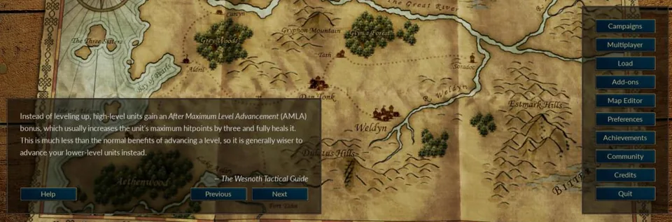
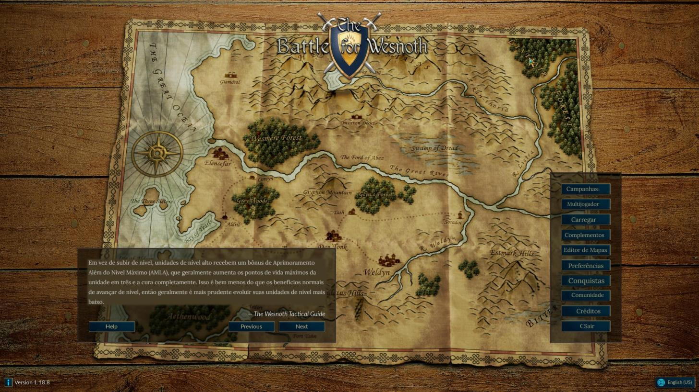
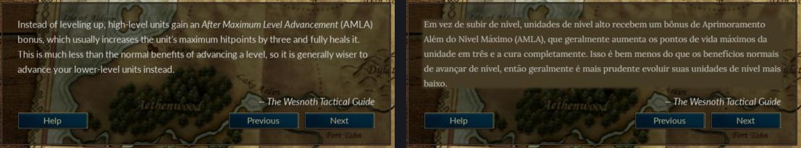
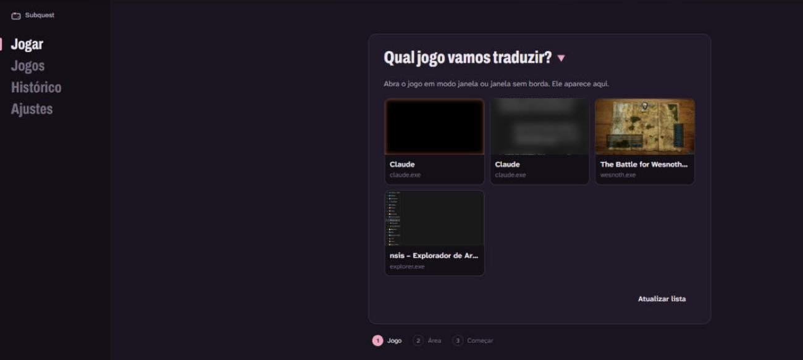
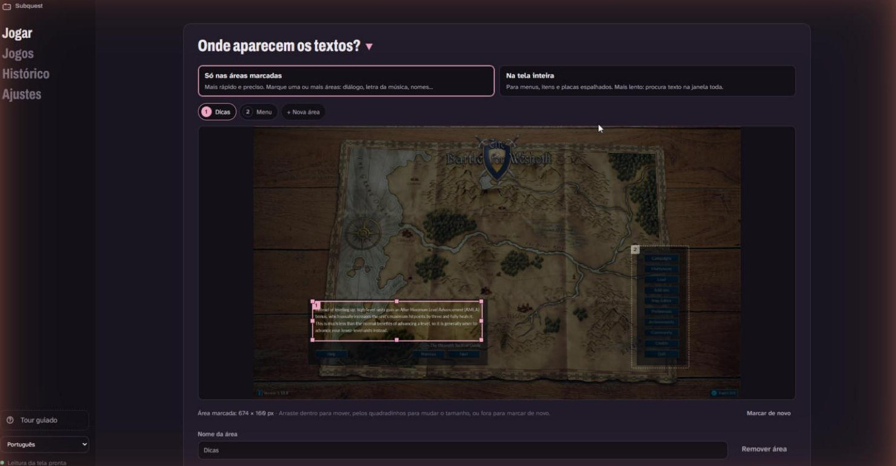
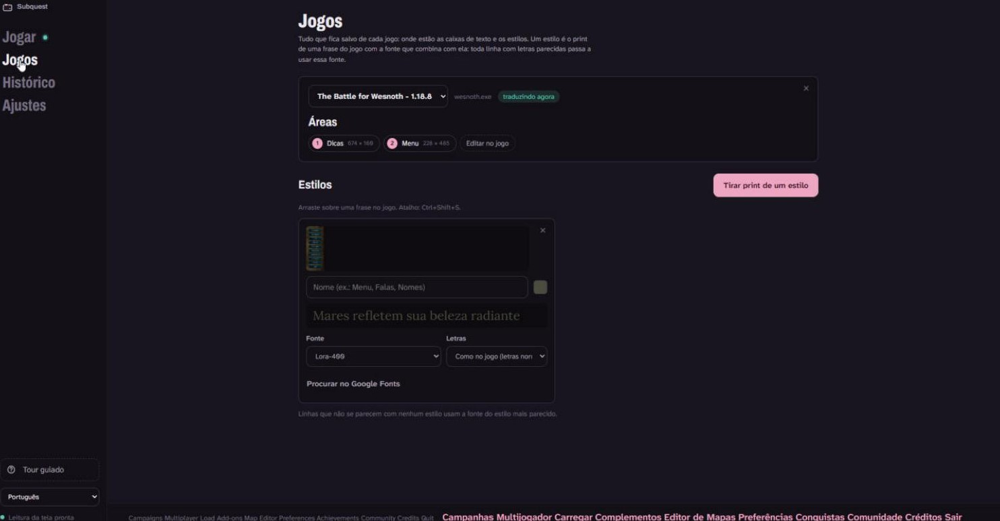
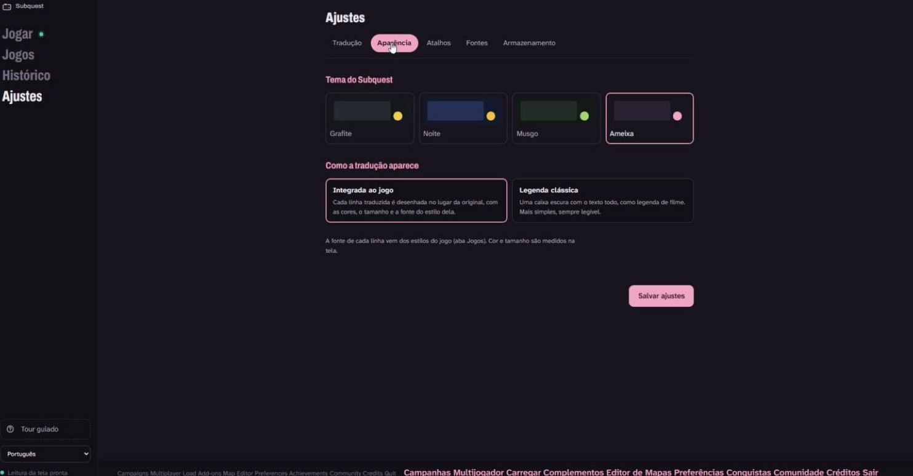
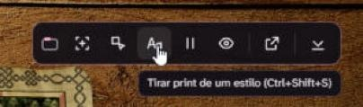

<p align="center">
  
</p>

# Subquest: Real-Time Game Translator

Play any game in your language. Subquest reads the dialogue on your screen, translates it with context-aware AI and shows the translation over the game, without stealing focus.

> 🇧🇷 [Leia em português](README.pt-BR.md)

<p align="center">
  
</p>

**Status:** first version (v0.1.0), Windows only. See the [Roadmap](#roadmap) for what's next.

## Install

1. Download `Subquest_x.y.z_x64-setup.exe` from the [Releases](https://github.com/The-Jonas/Subquest/releases) page and run it. Windows may warn that the publisher is unknown (the installer isn't signed yet): click **More info → Run anyway**.
2. Open Subquest. A guided tour shows each screen; you can open it again any time from the menu.
3. In **Settings → Translation**, paste an API key for the translator. [Google AI Studio](https://aistudio.google.com/apikey) gives a free Gemini key; it stays on your computer.
4. Run the game **windowed or borderless** (exclusive fullscreen blocks the capture), pick it in **Play**, mark where the text appears and start.

Requires Windows 10 (version 1903 or newer) or Windows 11. Japanese, Chinese or Korean games also need that language's pack installed in Windows (Settings → Time & language → Language).

## What it looks like

*Screenshots with [The Battle for Wesnoth](https://www.wesnoth.org/), a free and open-source game.*

| | |
|---|---|
|  |  |
| **In the game.** The tip and the menu, translated where they were. | **Before and after.** The translation stays inside the box, in the game's size and spacing. |
|  |  |
| **Pick the game** by its picture. | **Mark the areas** where text appears: move, resize, rename. |
|  |  |
| **Games:** areas and styles (a print of the game's text and the font that matches it). | **Themes** and the choice between drawn-in-place or a classic subtitle. |

The in-game bar (shortcut Ctrl+Shift+B) marks areas, takes style prints, pauses and hides the translation without leaving the game:

<p align="center"></p>

## Why another translator?

Existing tools work, but tend to be slow, translate each line in isolation and bury the user under settings. Subquest focuses on three things:

- **Speed.** GPU window capture, OCR only when the text actually changes *and* stops changing, and a pipeline that always drops stale frames instead of queueing them.
- **Better translations.** Language models receive the previous lines and are told to fix OCR mistakes; a quick translator fills the gap while they answer.
- **A clean interface.** Three steps to start: pick the game, mark the dialogue area, start.

## Architecture

```
┌──────────────── core/ (C++ · subquest_core.dll) ─────────────────┐
│ capture (WGC) ─▶ change detector ─▶ [latest slot] ─▶ OCR thread  │
│ window list · window position                         │ callback │
└───────────────────────────────────────────────────────┼──────────┘
                                   C API (core_api.h)   │
┌───────────── app/src-tauri/ (Rust) ───────────────────▼──────────┐
│ FFI bridge · streaming translator (context, cache) · settings    │
│ overlay window that follows the game                             │
└────────────────────────────────▲─────────────────────────────────┘
                                 │ Tauri commands / events
┌──────────────── app/src/ (Svelte 5 + TypeScript) ────────────────┐
│ Play · Games · History · Settings · tour · overlay · toolbar     │
└──────────────────────────────────────────────────────────────────┘
```

| Layer | Language | Responsibility |
|---|---|---|
| `core/` | C++20 | Window capture, change detection, OCR, window position. Exposes a small C API. |
| `app/src-tauri/` | Rust | Loads the core DLL at runtime, translation, cache, settings, the overlay window. |
| `app/src/` | Svelte 5 + TS | User interface, the overlay page and translations of the interface. |

### Key ideas

- **Latest slot instead of a queue** (`core/src/pipeline/latest_slot.h`): if OCR is busy, only the newest frame waits; older ones are dropped. Latency never piles up.
- **Change detector** (`core/src/vision/change_detector.cpp`): compares grayscale thumbnails and fires once the text changed *and* stayed still for a few frames, so typewriter animations don't trigger OCR on every letter.
- **One translator for many services** (`app/src-tauri/src/translate/openai_compat.rs`): the OpenAI-compatible protocol covers OpenAI, Gemini, OpenRouter, Ollama and LM Studio by changing only the URL and model.

## Building from source (Windows)

Only needed to change the code; to use Subquest, [install it](#install).

Requirements: Visual Studio 2022 (C++ workload), CMake 3.24+, Rust (stable), Node.js 20+.

```powershell
# 1. Core (also copies the DLL to app/src-tauri/bin)
cd core
cmake --preset windows-release
cmake --build --preset release
ctest --test-dir build -C Release --output-on-failure

# 2. App
cd ../app
npm install
npm run tauri dev
```

To work only on the interface, `npm run dev` runs it in the browser with sample data; no Rust or C++ needed.

### Installer

With the core built (step 1 above, which puts the DLL in `app/src-tauri/bin`):

```powershell
cd app
npm run tauri build
```

The installer is written to `app/src-tauri/target/release/bundle/nsis/`. It carries the core DLL and installs WebView2 if the PC doesn't have it; both runtimes are linked statically, so nothing else is needed.

## Roadmap

**Done in v0.1.0:** window capture, OCR, two translation layers (a fast one first, the language model replaces it), translation drawn in place with the game's own fonts (text styles), marked areas and whole-screen mode, the in-game bar and shortcuts, history, guided tour, themes and the installer.

From here, the essentials first: what everything else builds on, so it never has to be redone.

1. **Foundation.** Automated tests for the overlay layout and the change detector; versioned game profiles with migration, so updates never lose what a player set up; a pluggable OCR engine.
2. **Translation quality.** A per-game glossary (names always translated the same way) and lower latency from line to translation.
3. **Perfect boxes.** Rebuild the box's own background behind the translation instead of a flat patch; reproduce effects (typewriter, shaking letters, colored words) and keep icons in place.
4. **Perfect whole screen.** The same, for text anywhere on screen.
5. **Expansion.**
   - **PaddleOCR** (ONNX Runtime + DirectML): better Japanese, Chinese and Korean, and the base for other systems. Windows OCR already reads them when the Windows language pack is installed.
   - **Linux**, aimed at the Steam Deck: X11 first, Wayland later (capture asks for permission and apps can't place themselves over other windows there).
   - **macOS**: ScreenCaptureKit and the Vision framework.
   - A second-screen mode for consoles and phones, Android, and text hooking for supported engines.

## Contributing

Code, comments and commit messages are in English. To translate the interface, copy `app/src/lib/i18n/locales/pt-BR.json` to a new language file and register it in `app/src/lib/i18n/index.svelte.ts`.

## License

[GNU GPL v3.0](LICENSE). Third-party licenses are listed in [THIRD_PARTY_NOTICES.md](THIRD_PARTY_NOTICES.md).
