<p align="center">
  
</p>

# Subquest: translate anything on your screen, in real time

Subquest reads the text on any window, translates it with context-aware AI and shows the translation over the original, without stealing focus. Apps, videos, documents, installers, anything that shows text.

**And in games it goes further:** the translation is drawn *in the original's place*, with the game's own font, colors, letter case and spacing, as a translation patch would.

> 🇧🇷 [Leia em português](README.pt-BR.md)

<p align="center">
  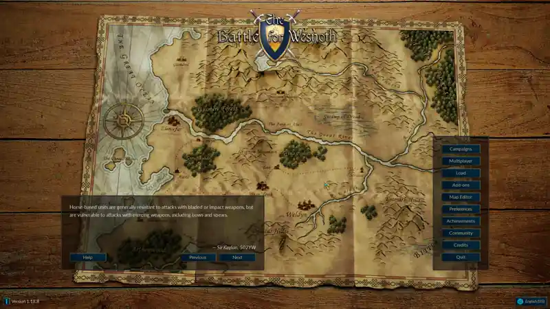
</p>

**Status:** v0.2.0, Windows only. v0.3.0 is in progress: see the [Roadmap](#roadmap).

## Install

1. Download `Subquest_x.y.z_x64-setup.exe` from the [Releases](https://github.com/The-Jonas/Subquest/releases) page and run it. Windows may warn that the publisher is unknown (the installer isn't signed yet): click **More info → Run anyway**.
2. Open Subquest. A guided tour shows each screen; you can open it again any time from the menu.
3. In **Settings → Translation**, paste an API key for the translator. [Google AI Studio](https://aistudio.google.com/apikey) gives a free Gemini key; it stays on your computer. A local model (Ollama, LM Studio) works too, with no key.
4. Pick the window in **Translate**, mark where the text appears and start. For games, run them **windowed or borderless** (exclusive fullscreen blocks the capture).

Requires Windows 10 (version 1903 or newer) or Windows 11. Japanese, Chinese or Korean text also needs that language's pack installed in Windows (Settings → Time & language → Language).

## What it is good at

| | |
|---|---|
| **Any window** | Apps, browsers, video players, installers, error messages, scanned documents: if it shows text, you can pick it. Browser translators only work inside the page; Subquest works on the window itself. |
| **Games, done right** | The original text is covered with the game's own background, and the translation takes its place in the same font, case, outline, colors and spacing, icons and buttons included. |
| **Context, not isolated lines** | The model receives the previous lines, fixes OCR mistakes, and follows a glossary you build for each game or app, so names are always translated the same way. |
| **Fast** | GPU capture, OCR only when the text changes *and* stops changing, stale frames dropped instead of queued, and a quick translator that fills the gap while the model answers. |
| **Private** | The capture and the OCR run on your PC, and the key stays on your computer. Only the text goes to the translator you chose, and with a local model nothing leaves your PC. |

### Be aware

- **Marking the areas where text shows up gives far better results** than reading the whole window. Whole-window reading is **experimental**: on busy screens translations may land out of place, be cut off or overlap.
- The quality of the in-place drawing is tuned on games (tested hardest on Hades II and Hitman); other kinds of content are still being tested.
- The translator may pick its own names for proper nouns until you add them to the glossary.

## Three steps

<p align="center">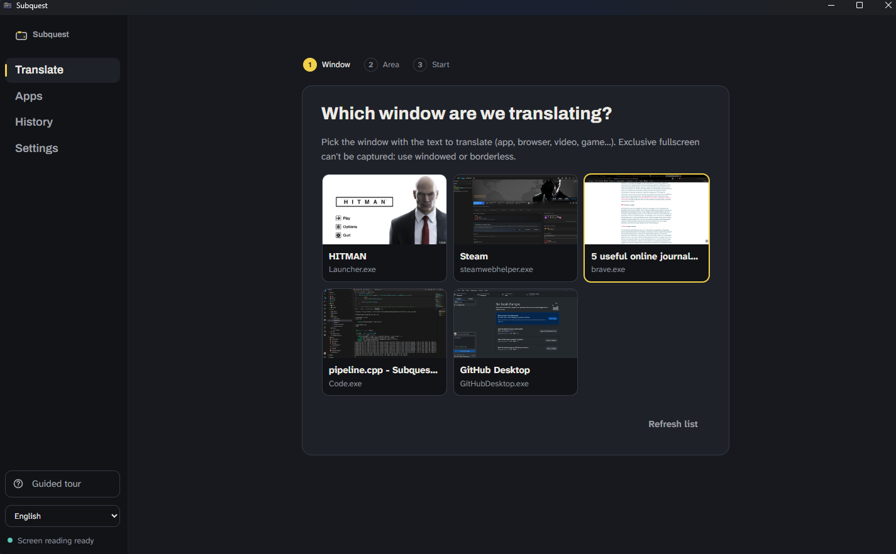</p>

1. **Pick the window.** Any open window shows up as a card with a live thumbnail.
2. **Mark where the text shows up** (or read the whole window, experimental).
3. **Start.** The translation appears over the original and the window keeps working as usual.

## Not just games

The same window picker takes a browser. Here, a book's page read in English and the translation drawn over it, in whole-window mode (still experimental, so a few details are off: the "Show less" link was read as part of the paragraph, and its original is still visible below):

| Original | Subquest |
|---|---|
| 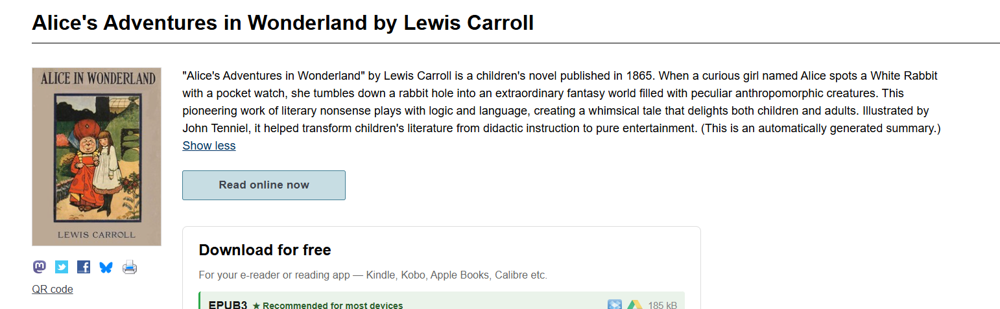 | 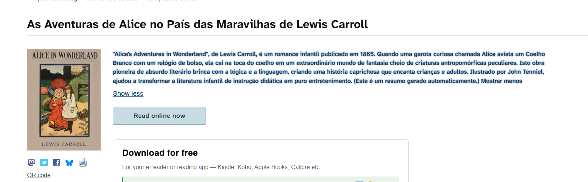 |

*Page: [Alice's Adventures in Wonderland](https://www.gutenberg.org/ebooks/11) on Project Gutenberg (the book is in the public domain). Subquest is not affiliated with Project Gutenberg.*

And in a game ([The Battle for Wesnoth](https://www.wesnoth.org/)), a dialogue box marked as an area: the English text is read and, a moment later, the Portuguese translation takes its place in the same box:

<p align="center">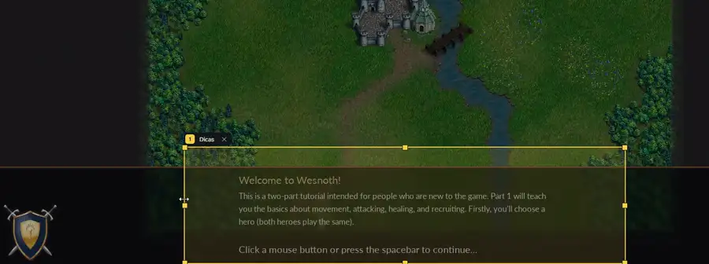</p>

The History screen shows each line's original, its translation and how long every step took. It also shows the model fixing OCR mistakes: below, the game's "press u or use the right-click menu" was read as "apress u or use the tight-clicksmenu" and still came out right. Lines already seen come from the cache, so here the translation showed up typically 121 ms after the text appeared; a new line waits for the translator (656 ms typical in an earlier test, on a long web page with Gemini).

<p align="center">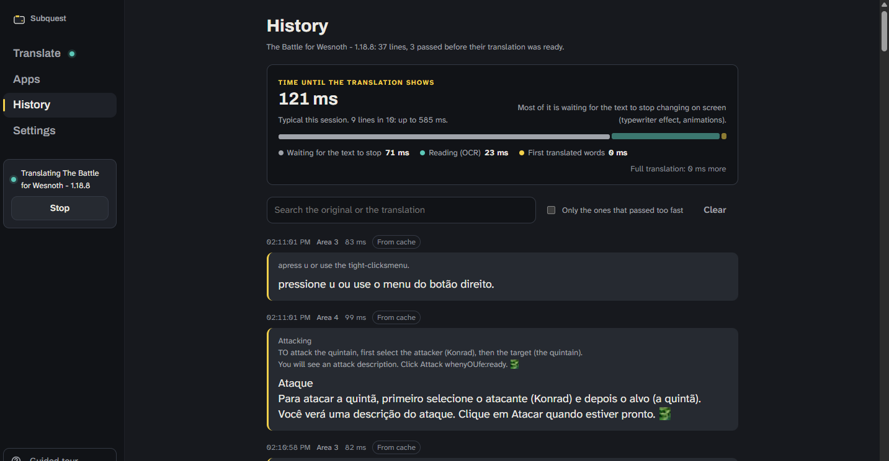</p>

## What it looks like

*Screenshots with [The Battle for Wesnoth](https://www.wesnoth.org/), a free and open-source game.*

| | |
|---|---|
| 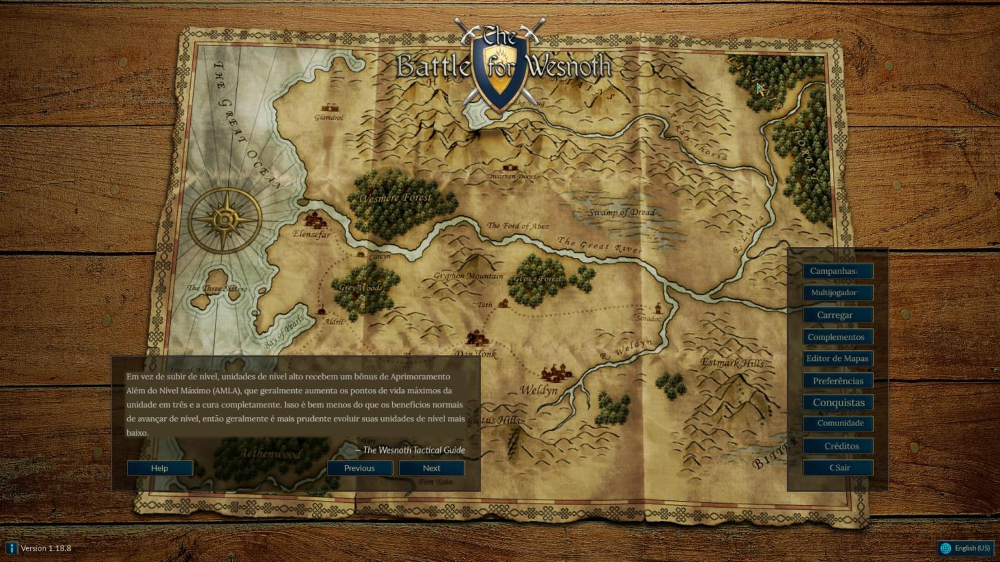 | 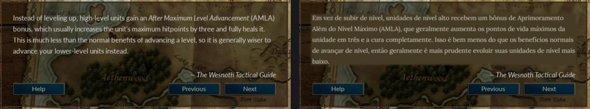 |
| **In place.** The tip and the menu, translated where they were. | **Before and after.** The translation stays inside the box, in the original's size and spacing. |
| 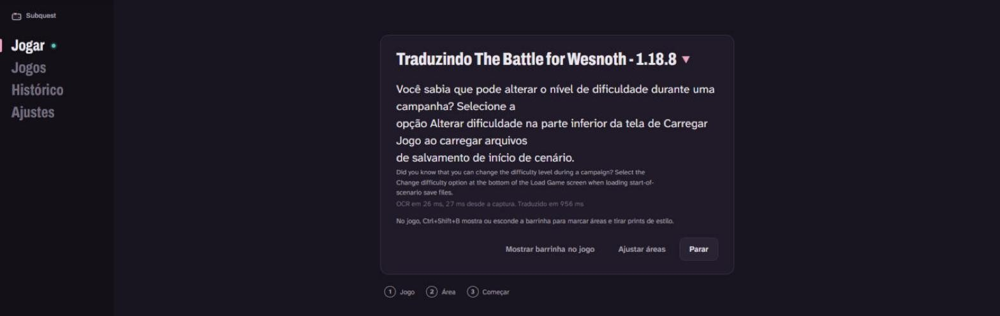 | 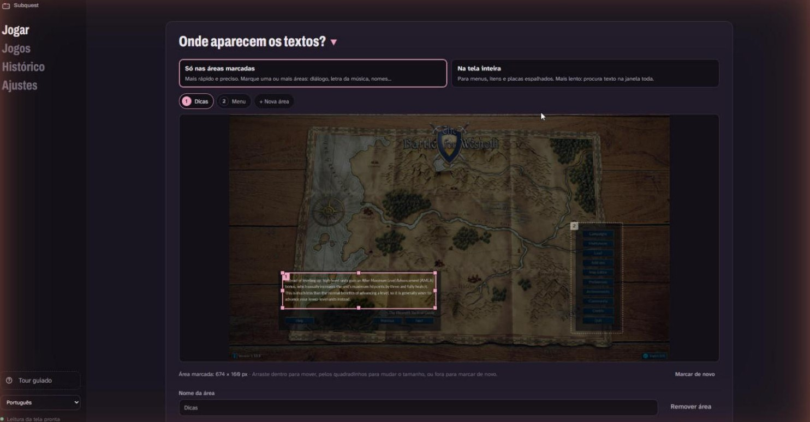 |
| **Follow the lines:** translation, original and how long each step took. | **Mark the areas** where text appears: move, resize, rename. |
| 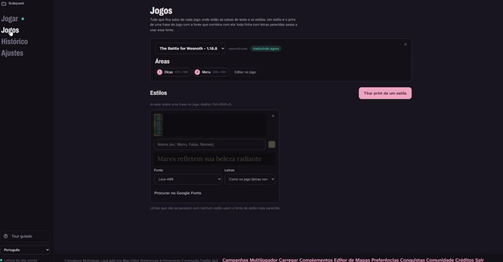 | 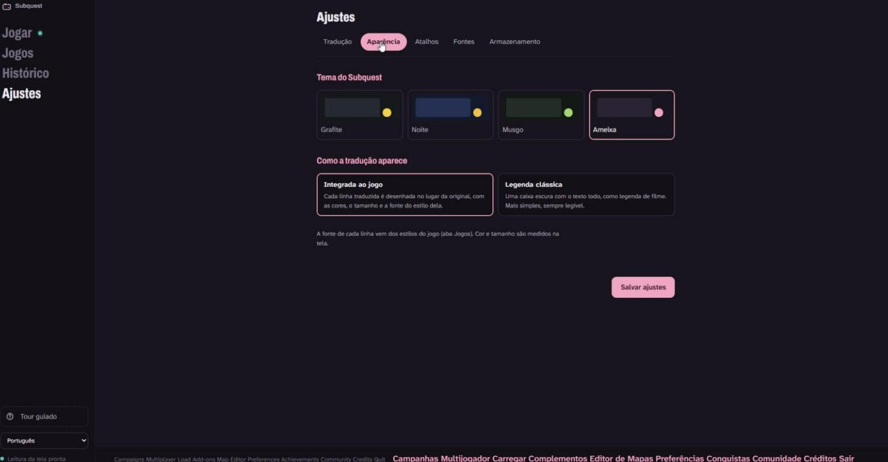 |
| **Apps:** areas and styles (a print of the original text and the font that matches it). | **Themes** and the choice between drawn-in-place or a classic subtitle. |

The in-game bar (shortcut Ctrl+Shift+B) marks areas, takes style prints, picks glossary terms, pauses and hides the translation without leaving the window:

<p align="center">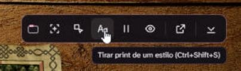</p>

| Shortcut | Does |
|---|---|
| Ctrl+Shift+B | Show or hide the bar |
| Ctrl+Shift+A | Mark an area |
| Ctrl+Shift+E | Edit areas |
| Ctrl+Shift+S | Take a style print |
| Ctrl+Shift+G | Pick a glossary term over the screen |
| Ctrl+Shift+T | Pause or resume |
| Ctrl+Shift+H | Hide or show the translation |
| Ctrl+Shift+M | Move the mouse and focus to the bar, and back to the window |

All of them can be changed in the Shortcuts screen.

## Architecture

```
┌──────────────── core/ (C++ · subquest_core.dll) ─────────────────┐
│ capture (WGC) ─▶ change detector ─▶ [latest slot] ─▶ OCR thread  │
│ window list · window position                         │ callback │
└───────────────────────────────────────────────────────┼──────────┘
                                   C API (core_api.h)   │
┌───────────── app/src-tauri/ (Rust) ───────────────────▼──────────┐
│ FFI bridge · streaming translator (context, cache) · settings    │
│ overlay window that follows the captured window                  │
└────────────────────────────────▲─────────────────────────────────┘
                                 │ Tauri commands / events
┌──────────────── app/src/ (Svelte 5 + TypeScript) ────────────────┐
│ Translate · Apps · History · Settings · tour · overlay · toolbar │
└──────────────────────────────────────────────────────────────────┘
```

| Layer | Language | Responsibility |
|---|---|---|
| `core/` | C++20 | Window capture, change detection, OCR, text removal, window position. Exposes a small C API. |
| `app/src-tauri/` | Rust | Loads the core DLL at runtime, translation, cache, glossary, settings, the overlay window. |
| `app/src/` | Svelte 5 + TS | User interface, the overlay page and translations of the interface. |

### Key ideas

- **Latest slot instead of a queue** (`core/src/pipeline/latest_slot.h`): if OCR is busy, only the newest frame waits; older ones are dropped. Latency never piles up.
- **Change detector** (`core/src/vision/change_detector.cpp`): compares grayscale thumbnails and fires once the text changed *and* stayed still for a few frames, so typewriter animations don't trigger OCR on every letter.
- **Text taken out of the picture** (`core/src/vision/inpaint.cpp`): the original text is removed using the surrounding pixels, so the translation sits on the real, live background instead of a flat patch.
- **One translator for many services** (`app/src-tauri/src/translate/openai_compat.rs`): the OpenAI-compatible protocol covers OpenAI, Gemini, OpenRouter, Ollama and LM Studio by changing only the URL and model.
- **Pluggable OCR** (`core/src/ocr/ocr_engine.h`): Windows OCR today, more engines behind the same interface.

## Building from source (Windows)

Only needed to change the code; to use Subquest, [install it](#install).

Requirements: Visual Studio 2022 (C++ workload), CMake 3.24+, Rust (stable), Node.js 20+.

```powershell
# 1. Core (also copies the DLL to app/src-tauri/bin)
cd core
cmake --preset windows-release
cmake --build --preset release
ctest --test-dir build -C Release --output-on-failure

# 2. App
cd ../app
npm install
npm run tauri dev
```

To work only on the interface, `npm run dev` runs it in the browser with sample data; no Rust or C++ needed.

### Installer

With the core built (step 1 above, which puts the DLL in `app/src-tauri/bin`):

```powershell
cd app
npm run tauri build
```

The installer is written to `app/src-tauri/target/release/bundle/nsis/`. It carries the core DLL and installs WebView2 if the PC doesn't have it; both runtimes are linked statically, so nothing else is needed.

## Roadmap

**Done so far (v0.1.0 and v0.2.0):** window capture, OCR, two translation layers (a fast one first, the language model replaces it), translation drawn in place with the original's font, case, colors and effects, icons kept in place, text removed with the real background, marked areas and whole-window mode, a per-game glossary, versioned profiles with migration, a pluggable OCR engine, the in-game bar and shortcuts, history, guided tour, themes and the installer.

**Next, v0.3.0: Subquest for everything on screen.** Games stay the showcase; these steps open the door to the rest:

1. **One-shot translation.** A shortcut, drag a rectangle over anything and see the translation once. For comics, scanned documents, images and videos that don't need constant reading.
2. **Reliable whole window.** Take whole-window reading out of "experimental": text in the right place, no overlaps, no cut-off words.
3. **Copy the text.** Copy what was read from an image or video, original or translated.
4. **Better OCR for Asian languages.** **PaddleOCR** (ONNX Runtime + DirectML) as an optional download: better Japanese, Chinese and Korean, including vertical text. Windows OCR already reads them when the Windows language pack is installed.
5. **Plain-language interface.** The app speaks of windows and profiles, not only games, and is easy to use without reading anything first.

**Later:**
- Translation quality: proper nouns through the glossary, italic detection, fewer invented placeholders.
- A tray icon and a lighter background mode.
- **Linux**, aimed at the Steam Deck: X11 first, Wayland later (capture asks for permission and apps can't place themselves over other windows there).
- **macOS**: ScreenCaptureKit and the Vision framework.
- A second-screen mode for consoles and phones, Android, and text hooking for supported game engines.

## Contributing

Code, comments and commit messages are in English. To translate the interface, copy `app/src/lib/i18n/locales/pt-BR.json` to a new language file and register it in `app/src/lib/i18n/index.svelte.ts`.

## License

[GNU GPL v3.0](LICENSE). Third-party licenses are listed in [THIRD_PARTY_NOTICES.md](THIRD_PARTY_NOTICES.md).
