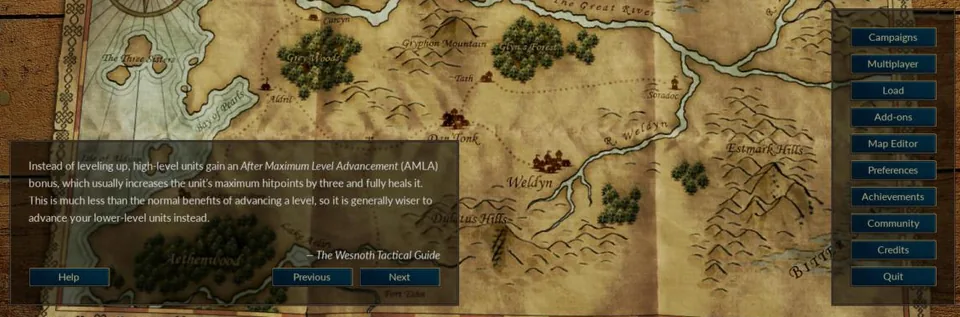
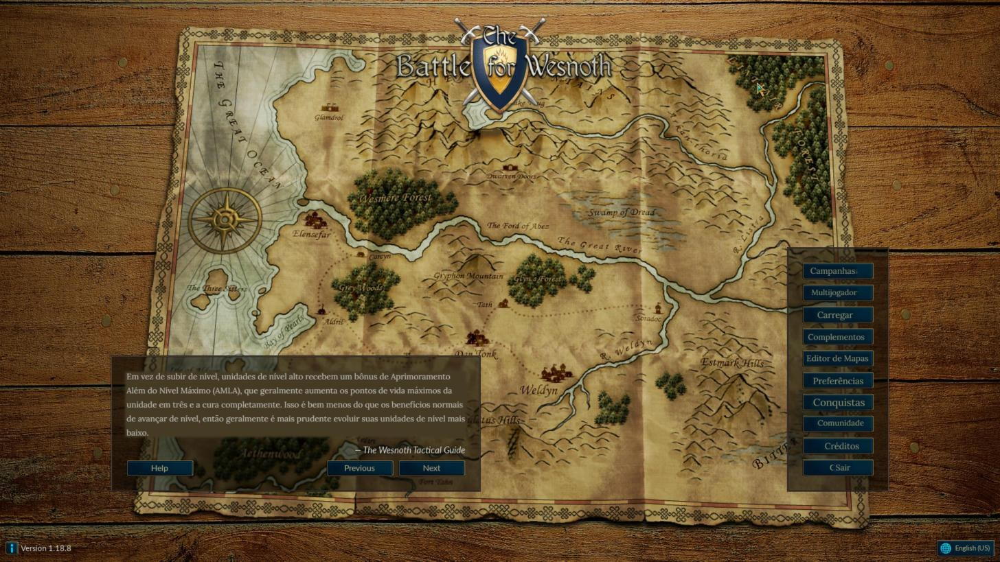
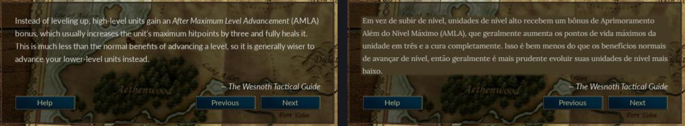
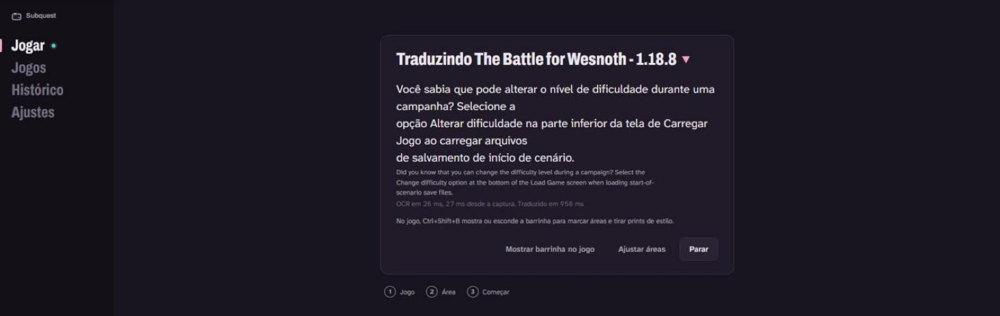
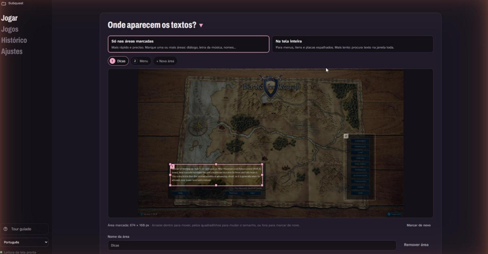
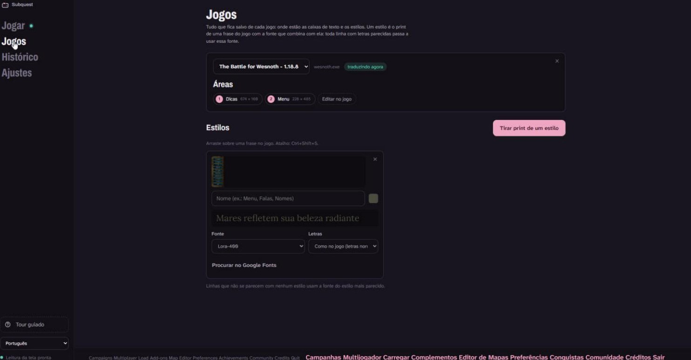
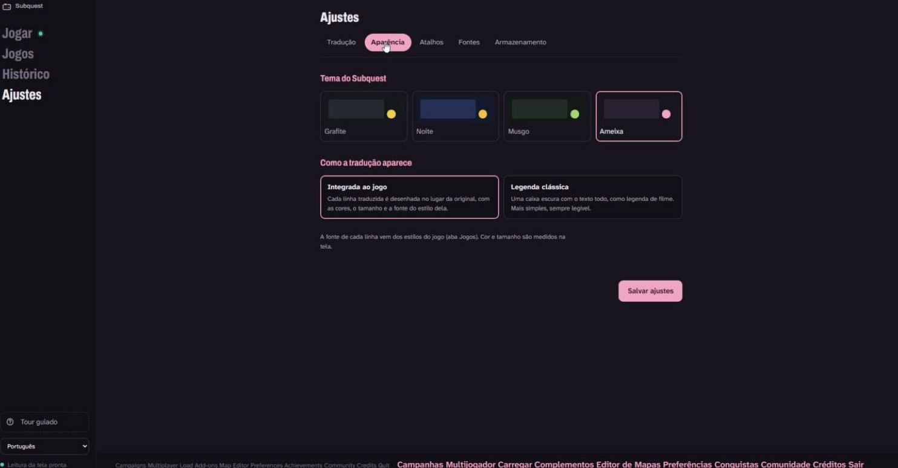
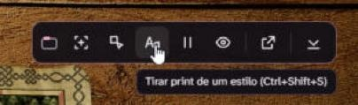

<p align="center">
  
</p>

# Subquest: tradutor de jogos em tempo real

Jogue qualquer jogo no seu idioma. O Subquest lê os diálogos da tela, traduz com IA que entende o contexto e mostra a tradução por cima do jogo, sem roubar o foco.

> 🇺🇸 [Read in English](README.md)

<p align="center">
  
</p>

**Situação:** primeira versão (v0.1.0), só para Windows. Veja o [roteiro](#roteiro) para os próximos passos.

## Instalar

1. Baixe o `Subquest_x.y.z_x64-setup.exe` na página de [Releases](https://github.com/The-Jonas/Subquest/releases) e execute. O Windows pode avisar que o editor é desconhecido (o instalador ainda não é assinado): clique em **Mais informações → Executar assim mesmo**.
2. Abra o Subquest. Um tour guiado mostra cada tela; dá para abrir de novo quando quiser pelo menu.
3. Em **Ajustes → Tradução**, cole uma chave de API do tradutor. O [Google AI Studio](https://aistudio.google.com/apikey) dá uma chave grátis do Gemini; ela fica só no seu computador.
4. Deixe o jogo **em janela ou janela sem borda** (a tela cheia exclusiva bloqueia a captura), escolha ele em **Jogar**, marque onde os textos aparecem e comece.

Precisa do Windows 10 (versão 1903 ou mais nova) ou Windows 11. Jogos em japonês, chinês ou coreano também precisam do pacote desse idioma instalado no Windows (Configurações → Hora e idioma → Idioma).

## Como é

*Capturas com [The Battle for Wesnoth](https://www.wesnoth.org/), um jogo livre e de código aberto.*

| | |
|---|---|
|  |  |
| **No jogo.** A dica e o menu traduzidos no lugar onde estavam. | **Antes e depois.** A tradução fica dentro da caixa, no tamanho e no espaçamento do jogo. |
|  |  |
| **Acompanhe as falas:** tradução, original e quanto tempo cada etapa levou. | **Marque as áreas** onde o texto aparece: mova, redimensione, renomeie. |
|  |  |
| **Jogos:** áreas e estilos (um print do texto do jogo com a fonte que combina com ele). | **Temas** e a escolha entre desenhar no lugar ou legenda clássica. |

A barrinha no jogo (atalho Ctrl+Shift+B) marca áreas, tira prints de estilo, pausa e esconde a tradução sem sair do jogo:

<p align="center"></p>

## Por que mais um tradutor?

As ferramentas que existem funcionam, mas costumam ser lentas, traduzem cada fala isolada e enchem o usuário de opções. O Subquest foca em três coisas:

- **Velocidade.** Captura da janela pela GPU, OCR só quando o texto muda *e* para de mudar, e um pipeline que descarta quadros velhos em vez de enfileirá-los.
- **Traduções melhores.** O modelo de linguagem recebe as falas anteriores e é instruído a corrigir erros de OCR; um tradutor rápido tapa o buraco enquanto ele responde.
- **Interface limpa.** Três passos para começar: escolher o jogo, marcar a área das falas e começar.

A arquitetura completa, com o diagrama das camadas, está no [README em inglês](README.md#architecture).

## Compilar o código (Windows)

Só é preciso para mexer no código; para usar o Subquest, basta [instalar](#instalar).

Requisitos: Visual Studio 2022 (carga de trabalho C++), CMake 3.24+, Rust (stable) e Node.js 20+.

```powershell
# 1. Núcleo (também copia a DLL para app/src-tauri/bin)
cd core
cmake --preset windows-release
cmake --build --preset release
ctest --test-dir build -C Release --output-on-failure

# 2. App
cd ../app
npm install
npm run tauri dev
```

Para mexer só na interface, `npm run dev` roda no navegador com dados de exemplo, sem precisar de Rust nem C++.

### Instalador

Com o núcleo compilado (passo 1 acima, que coloca a DLL em `app/src-tauri/bin`):

```powershell
cd app
npm run tauri build
```

O instalador fica em `app/src-tauri/target/release/bundle/nsis/`. Ele leva a DLL do núcleo junto e instala o WebView2 se o PC não tiver; os runtimes de C e C++ vão embutidos, então não precisa instalar mais nada.

## Roteiro

**Pronto na v0.1.0:** captura da janela, OCR, duas camadas de tradução (uma rápida primeiro, o modelo de linguagem substitui), tradução desenhada no lugar com as fontes do próprio jogo (estilos de texto), áreas marcadas e modo tela inteira, a barrinha e os atalhos, histórico, tour guiado, temas e o instalador.

Daqui para frente, o essencial primeiro: o que todo o resto usa, para nunca precisar ser refeito.

1. **Base.** Testes automáticos do posicionamento da tradução e do detector de mudança; perfis de jogo com versão e migração, para atualizações nunca perderem o que o jogador configurou; OCR trocável.
2. **Qualidade da tradução.** Glossário por jogo (nomes sempre traduzidos do mesmo jeito) e menos tempo entre a fala e a tradução.
3. **Caixas perfeitas.** Reconstruir o fundo da própria caixa atrás da tradução, em vez de uma mancha de cor; reproduzir efeitos (digitação, letras tremendo, palavras coloridas) e manter os ícones no lugar.
4. **Tela inteira perfeita.** O mesmo, para texto em qualquer lugar da tela.
5. **Expansão.**
   - **PaddleOCR** (ONNX Runtime + DirectML): japonês, chinês e coreano melhores, e a base para outros sistemas. O OCR do Windows já lê esses idiomas quando o pacote de idioma do Windows está instalado.
   - **Linux**, pensando no Steam Deck: primeiro X11, depois Wayland (lá a captura pede permissão e um app não pode ficar por cima de outras janelas).
   - **macOS**: ScreenCaptureKit e o framework Vision.
   - Modo segunda tela para consoles e celulares, Android e *text hooking* para engines suportadas.

## Licença

[GNU GPL v3.0](LICENSE). As licenças de terceiros estão em [THIRD_PARTY_NOTICES.md](THIRD_PARTY_NOTICES.md).
