<p align="center">
  
</p>

# Subquest: traduza qualquer coisa da sua tela, em tempo real

O Subquest lê o texto de qualquer janela, traduz com IA que entende o contexto e mostra a tradução por cima do original, sem roubar o foco. Programas, vídeos, documentos, instaladores, tudo que mostra texto.

**E nos jogos ele vai além:** a tradução é desenhada *no lugar do original*, com a fonte, as cores, as maiúsculas e o espaçamento do próprio jogo, como faria um patch de tradução.

> 🇺🇸 [Read in English](README.md)

<p align="center">
  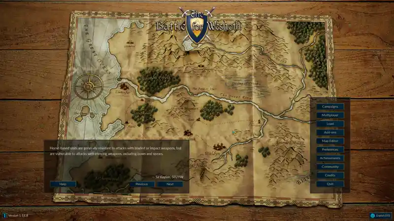
</p>

**Situação:** v0.2.1, só para Windows. A v0.3.0 é a próxima: veja o [roteiro](#roteiro).

## Instalar

1. Baixe o `Subquest_x.y.z_x64-setup.exe` na página de [Releases](https://github.com/The-Jonas/Subquest/releases) e execute. O Windows pode avisar que o editor é desconhecido (o instalador ainda não é assinado): clique em **Mais informações → Executar assim mesmo**.
2. Abra o Subquest. Um tour guiado mostra cada tela; dá para abrir de novo quando quiser pelo menu.
3. Em **Ajustes → Tradução**, cole uma chave de API do tradutor. O [Google AI Studio](https://aistudio.google.com/apikey) dá uma chave grátis do Gemini; ela fica só no seu computador. Um modelo local (Ollama, LM Studio) também funciona, sem chave.
4. Escolha a janela em **Traduzir**, marque onde os textos aparecem e comece. Para jogos, deixe-os **em janela ou janela sem borda** (a tela cheia exclusiva bloqueia a captura).

Precisa do Windows 10 (versão 1903 ou mais nova) ou Windows 11. Textos em japonês, chinês ou coreano também precisam do pacote desse idioma instalado no Windows (Configurações → Hora e idioma → Idioma).

## No que ele é bom

| | |
|---|---|
| **Qualquer janela** | Programas, navegadores, players de vídeo, instaladores, mensagens de erro, documentos escaneados: se mostra texto, dá para escolher. Os tradutores de navegador só funcionam dentro da página; o Subquest trabalha na própria janela. |
| **Jogos, bem feitos** | O texto original é coberto com o fundo do próprio jogo, e a tradução ocupa o lugar dele com a mesma fonte, caixa, contorno, cores e espaçamento, ícones e botões inclusos. |
| **Contexto, não falas isoladas** | O modelo recebe as falas anteriores, corrige erros de OCR e segue um glossário que você monta para cada jogo ou programa, então os nomes saem sempre iguais. |
| **Rápido** | Captura pela GPU, OCR só quando o texto muda *e* para de mudar, quadros velhos descartados em vez de enfileirados, e um tradutor rápido que tapa o buraco enquanto o modelo responde. |
| **Privado** | A captura e o OCR rodam no seu PC, e a chave fica no seu computador. Só o texto vai para o tradutor que você escolheu, e com um modelo local nada sai do PC. |

### Fique ciente

- **Marcar as áreas onde o texto aparece dá resultados bem melhores** do que ler a janela inteira. A leitura da janela inteira é **experimental**: em telas cheias, as traduções podem cair fora do lugar, ficar cortadas ou se sobrepor.
- A qualidade do desenho no lugar foi ajustada em jogos (testada com mais força no Hades II e no Hitman); os outros tipos de conteúdo ainda estão em teste.
- O tradutor pode escolher os próprios nomes para nomes próprios até você adicioná-los ao glossário.

## Três passos

<p align="center">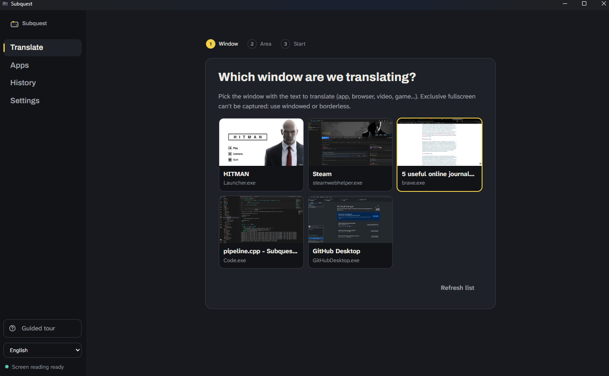</p>

1. **Escolha a janela.** Qualquer janela aberta aparece como um cartão com miniatura ao vivo.
2. **Marque onde o texto aparece** (ou leia a janela inteira, experimental).
3. **Comece.** A tradução aparece por cima do original e a janela continua funcionando normalmente.

## Não é só para jogos

O mesmo seletor de janelas aceita um navegador. Aqui, a página de um livro lida em inglês e a tradução desenhada por cima, no modo janela inteira (ainda experimental, então alguns detalhes ficam errados: o link "Show less" foi lido como parte do parágrafo, e o original dele continua visível abaixo):

| Original | Subquest |
|---|---|
| 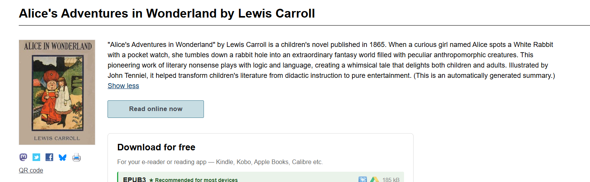 | 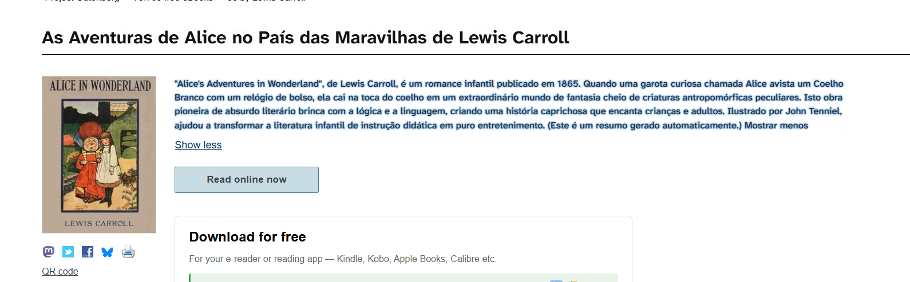 |

*Página: [Alice's Adventures in Wonderland](https://www.gutenberg.org/ebooks/11), no Project Gutenberg (o livro é de domínio público). O Subquest não é afiliado ao Project Gutenberg.*

E num jogo ([The Battle for Wesnoth](https://www.wesnoth.org/)), uma caixa de diálogo marcada como área: o texto em inglês é lido e, um instante depois, a tradução em português ocupa o lugar dele, na mesma caixa:

<p align="center">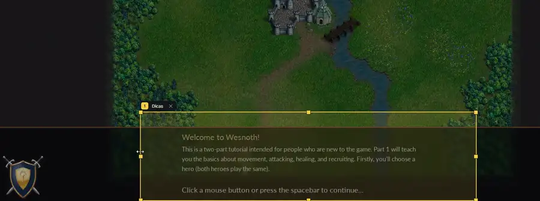</p>

A tela Histórico mostra o original de cada linha, a tradução e quanto tempo cada etapa levou. Ela também mostra o modelo corrigindo erros de OCR: abaixo, o "press u or use the right-click menu" do jogo foi lido como "apress u or use the tight-clicksmenu" e saiu certo mesmo assim. Linhas já vistas vêm do cache, então aqui a tradução costumava aparecer 121 ms depois do texto surgir; uma linha nova espera o tradutor (656 ms típicos num teste anterior, numa página longa da web com o Gemini).

<p align="center">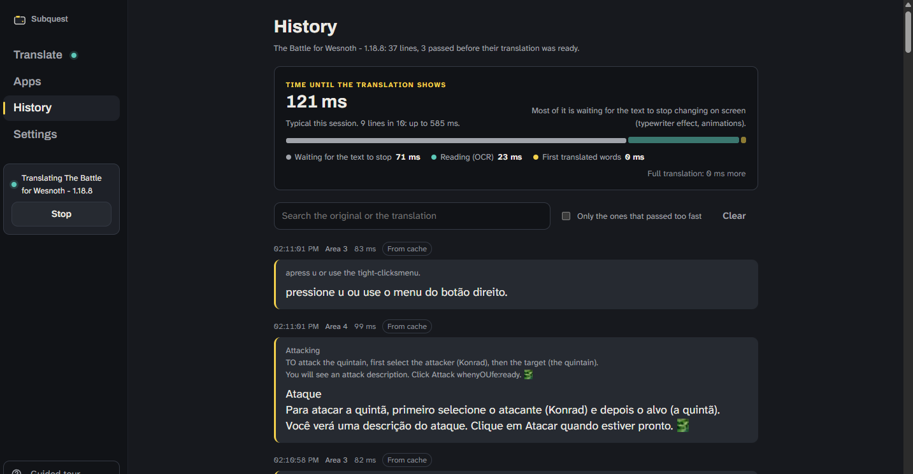</p>

## Como é

*Capturas com [The Battle for Wesnoth](https://www.wesnoth.org/), um jogo livre e de código aberto.*

| | |
|---|---|
| 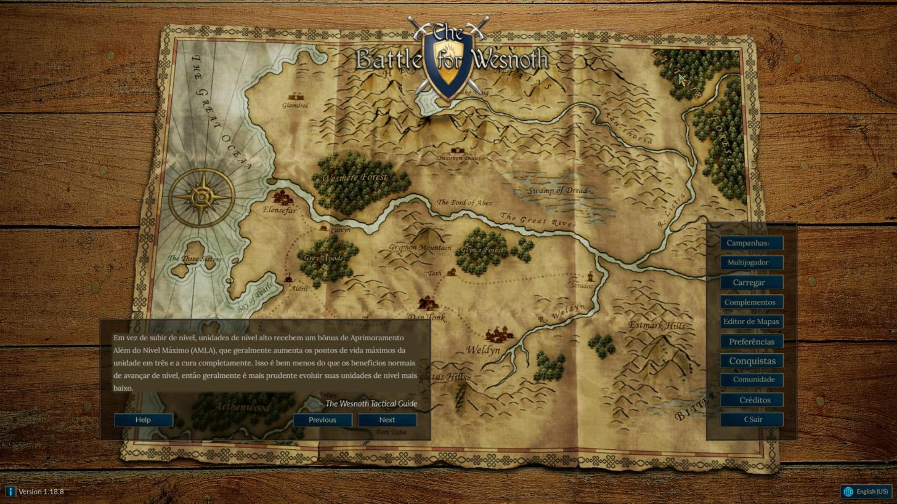 | 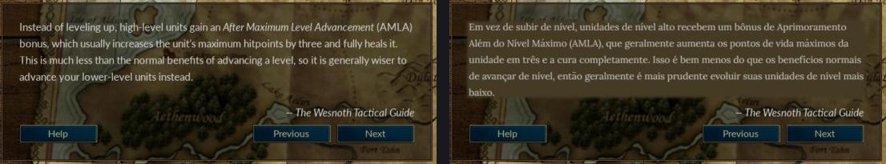 |
| **No lugar.** A dica e o menu traduzidos onde estavam. | **Antes e depois.** A tradução fica dentro da caixa, no tamanho e no espaçamento do original. |
| 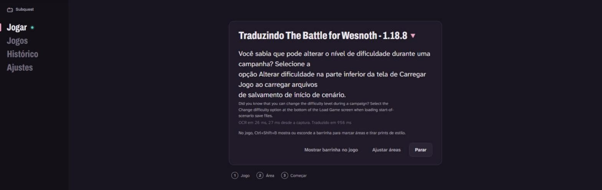 | 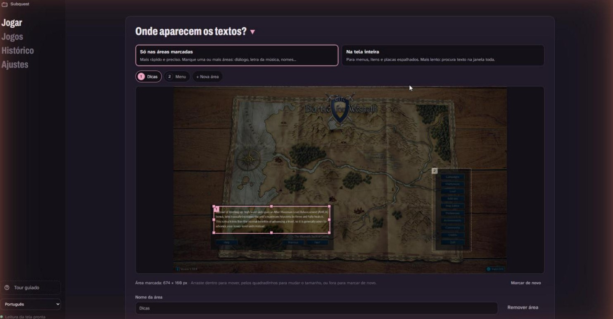 |
| **Acompanhe as falas:** tradução, original e quanto tempo cada etapa levou. | **Marque as áreas** onde o texto aparece: mova, redimensione, renomeie. |
| 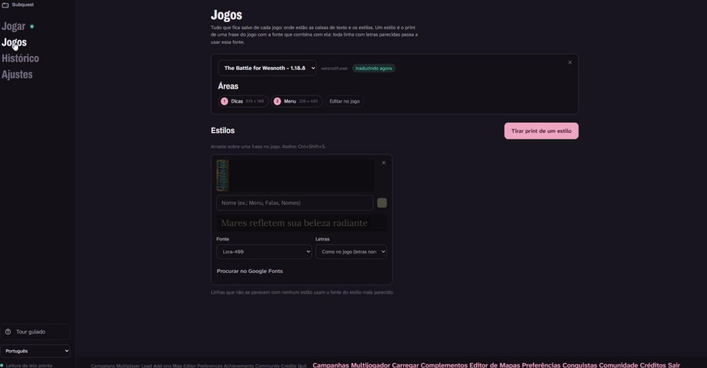 | 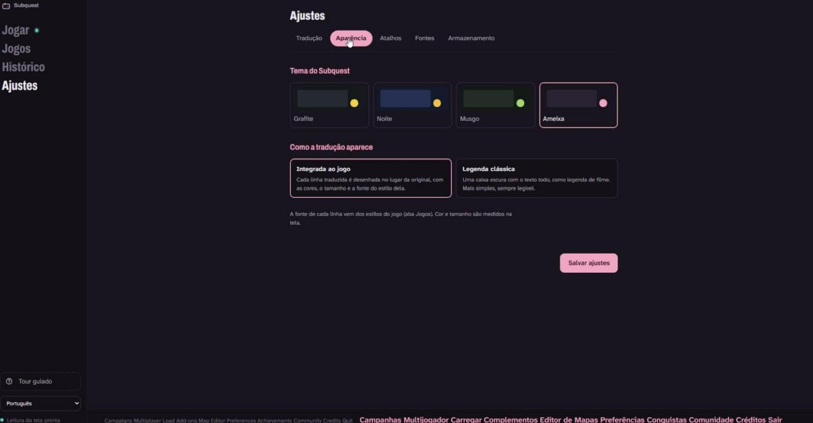 |
| **Programas:** áreas e estilos (um print do texto original com a fonte que combina com ele). | **Temas** e a escolha entre desenhar no lugar ou legenda clássica. |

A barrinha (atalho Ctrl+Shift+B) marca áreas, tira prints de estilo, escolhe termos do glossário, pausa e esconde a tradução sem sair da janela:

<p align="center">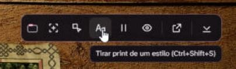</p>

| Atalho | Faz |
|---|---|
| Ctrl+Shift+B | Mostrar ou esconder a barra |
| Ctrl+Shift+A | Marcar uma área |
| Ctrl+Shift+E | Editar as áreas |
| Ctrl+Shift+S | Tirar um print de estilo |
| Ctrl+Shift+G | Escolher um termo do glossário sobre a tela |
| Ctrl+Shift+T | Pausar ou retomar |
| Ctrl+Shift+H | Esconder ou mostrar a tradução |
| Ctrl+Shift+M | Levar o mouse e o foco para a barra, e devolver à janela |

Todos podem ser trocados na tela de Atalhos.

## Arquitetura

O diagrama das camadas e as ideias-chave estão no [README em inglês](README.md#architecture). Em resumo: o núcleo em C++ (`core/`) captura a janela e lê o texto, o app em Rust (`app/src-tauri/`) traduz e guarda perfis, glossário e ajustes, e a interface em Svelte (`app/src/`) desenha a tradução por cima da janela.

## Compilar o código (Windows)

Só é preciso para mexer no código; para usar o Subquest, basta [instalar](#instalar).

Requisitos: Visual Studio 2022 (carga de trabalho C++), CMake 3.24+, Rust (stable) e Node.js 20+.

```powershell
# 1. Núcleo (também copia a DLL para app/src-tauri/bin)
cd core
cmake --preset windows-release
cmake --build --preset release
ctest --test-dir build -C Release --output-on-failure

# 2. App
cd ../app
npm install
npm run tauri dev
```

Para mexer só na interface, `npm run dev` roda no navegador com dados de exemplo, sem precisar de Rust nem C++.

### Instalador

Com o núcleo compilado (passo 1 acima, que coloca a DLL em `app/src-tauri/bin`):

```powershell
cd app
npm run tauri build
```

O instalador fica em `app/src-tauri/target/release/bundle/nsis/`. Ele leva a DLL do núcleo junto e instala o WebView2 se o PC não tiver; os runtimes de C e C++ vão embutidos, então não precisa instalar mais nada.

## Roteiro

**Pronto até agora (até a v0.2.1):** captura da janela, OCR, duas camadas de tradução (uma rápida primeiro, o modelo de linguagem substitui), tradução desenhada no lugar com a fonte, as maiúsculas, as cores e os efeitos do original, ícones mantidos no lugar, texto removido com o fundo real, áreas marcadas e modo janela inteira, glossário por jogo, perfis com versão e migração, OCR trocável, a barrinha e os atalhos, histórico, tour guiado, temas e o instalador.

**Próximo, v0.3.0: o Subquest para tudo que aparece na tela.** Os jogos continuam sendo a vitrine; estes passos abrem a porta para o resto:

1. **Tradução pontual.** Um atalho, arraste um retângulo sobre qualquer coisa e veja a tradução uma vez. Para quadrinhos, documentos escaneados, imagens e vídeos que não precisam de leitura constante.
2. **Janela inteira confiável.** Tirar a leitura da janela inteira do "experimental": texto no lugar certo, sem sobreposição, sem palavras cortadas.
3. **Copiar o texto.** Copiar o que foi lido de uma imagem ou vídeo, original ou traduzido.
4. **OCR melhor para idiomas asiáticos.** **PaddleOCR** (ONNX Runtime + DirectML) como download opcional: japonês, chinês e coreano melhores, inclusive texto na vertical. O OCR do Windows já lê esses idiomas quando o pacote de idioma do Windows está instalado.
5. **Interface em linguagem simples.** O app fala de janelas e programas, não só de jogos, e é fácil de usar sem ler nada antes.

**Depois:**
- Qualidade da tradução: nomes próprios pelo glossário, detecção de itálico, menos marcadores inventados.
- Ícone na bandeja e um modo de fundo mais leve.
- **Linux**, pensando no Steam Deck: primeiro X11, depois Wayland (lá a captura pede permissão e um app não pode ficar por cima de outras janelas).
- **macOS**: ScreenCaptureKit e o framework Vision.
- Modo segunda tela para consoles e celulares, Android e *text hooking* para engines de jogo suportadas.

## Licença

[GNU GPL v3.0](LICENSE). As licenças de terceiros estão em [THIRD_PARTY_NOTICES.md](THIRD_PARTY_NOTICES.md).
